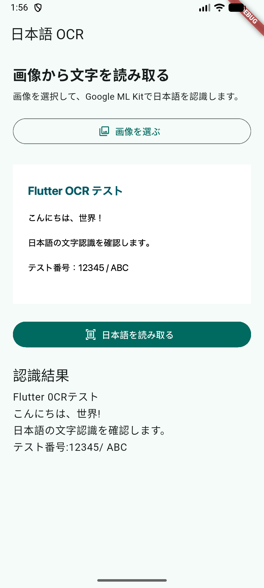

# 日本語OCRアプリ

FlutterとGoogle ML Kitを使った、日本語の文字認識を試す学習用アプリです。端末の写真ライブラリから画像を選び、画像内の文字を読み取って結果を表示します。

このリポジトリはソースコードをポートフォリオとして公開するためのものです。アプリのストア配信は予定していません。

## スクリーンショット

Androidエミュレーターでテスト画像を選び、日本語OCRを実行した画面です。



## 機能

- 写真ライブラリから画像を選択
- Google ML Kitによる日本語OCR
- 認識結果の表示とテキスト選択
- 画像選択・文字認識時のエラー表示
- OCR動作確認用画像（[`assets/ocr_sample.png`](assets/ocr_sample.png)）

## 使用技術

- Flutter / Dart
- [`google_mlkit_text_recognition`](https://pub.dev/packages/google_mlkit_text_recognition)
- [`image_picker`](https://pub.dev/packages/image_picker)
- Android: Google ML Kit Japanese Text Recognition
- iOS: Google ML Kit Japanese Text Recognition（CocoaPods）

## 動作環境

- Flutter SDK（プロジェクトの`pubspec.yaml`に記載のDart SDK制約を満たすバージョン）
- Android StudioとAndroid SDK（Androidで実行する場合）
- macOS、Xcode、CocoaPods（iOSで実行する場合）
- iOS Deployment Target: 15.5

Google ML KitのFlutterプラグインはAndroid/iOS向けです。Web、macOS、Windows、LinuxでのOCR動作は対象外です。

## 起動方法

リポジトリを取得し、プロジェクトのルートでFlutterパッケージを取得します。

```bash
git clone <このリポジトリのURL>
cd flutter_learning
flutter pub get
```

### Android

Androidエミュレーターを起動するか、Android端末を接続してから実行します。

```bash
flutter devices
flutter run -d <端末ID>
```

### iOS

初回はCocoaPods依存関係を取得します。

```bash
cd ios
pod install
cd ..
flutter devices
flutter run -d <端末ID>
```

iPhone実機で実行する場合は、Xcodeで`ios/Runner.xcworkspace`を開き、**Runner → TARGETSのRunner → Signing & Capabilities**で自分のTeamを選択してください。自動署名を有効にし、iPhoneでデベロッパーモードをオンにします。Bundle Identifierが利用できない場合は、Xcode上で自分用の一意な値に変更してください。

## OCRを試す

1. アプリで「画像を選ぶ」をタップします。
2. 文字が写った画像を選びます。動作確認には[`assets/ocr_sample.png`](assets/ocr_sample.png)を端末に保存して利用できます。
3. 「日本語を読み取る」をタップします。
4. 認識結果を画面上で確認・選択します。

## 開発用コマンド

```bash
flutter analyze
flutter run
```

`flutter analyze`はDartコードを静的解析し、`flutter run`は接続中の端末でアプリをビルドして起動します。

## シークレット検査（Gitleaks）

コミット時とプッシュ時にGitleaksを実行するローカルGitフックを用意しています。初回クローン後、Gitleaksをインストールしてフックを有効にしてください。

```bash
brew install gitleaks
./scripts/install-git-hooks.sh
```

- **コミット時**: ステージした差分を検査します。
- **プッシュ時**: リモートにまだないコミットを検査します。新規ブランチの初回プッシュでは、そのブランチの履歴を検査します。
- 検出またはGitleaks未インストール時は、コミット／プッシュを中止します。

この設定はローカルGitフックです。フックは`--no-verify`などで回避できるため、公開前にもシークレットを含めていないか確認してください。

## ライセンス

現時点でライセンスは設定していません。公開範囲や再利用条件を決めた後、必要に応じてライセンスを追加してください。
